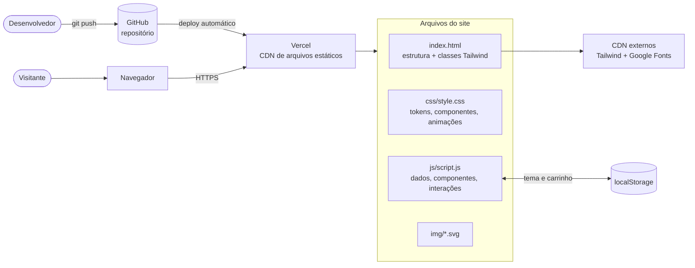
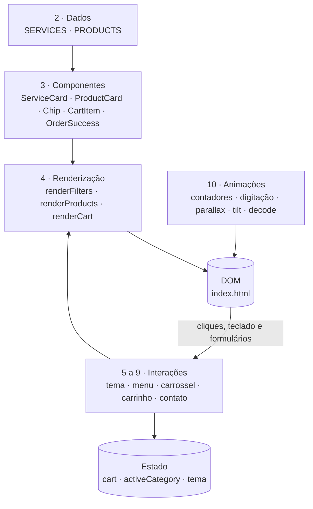
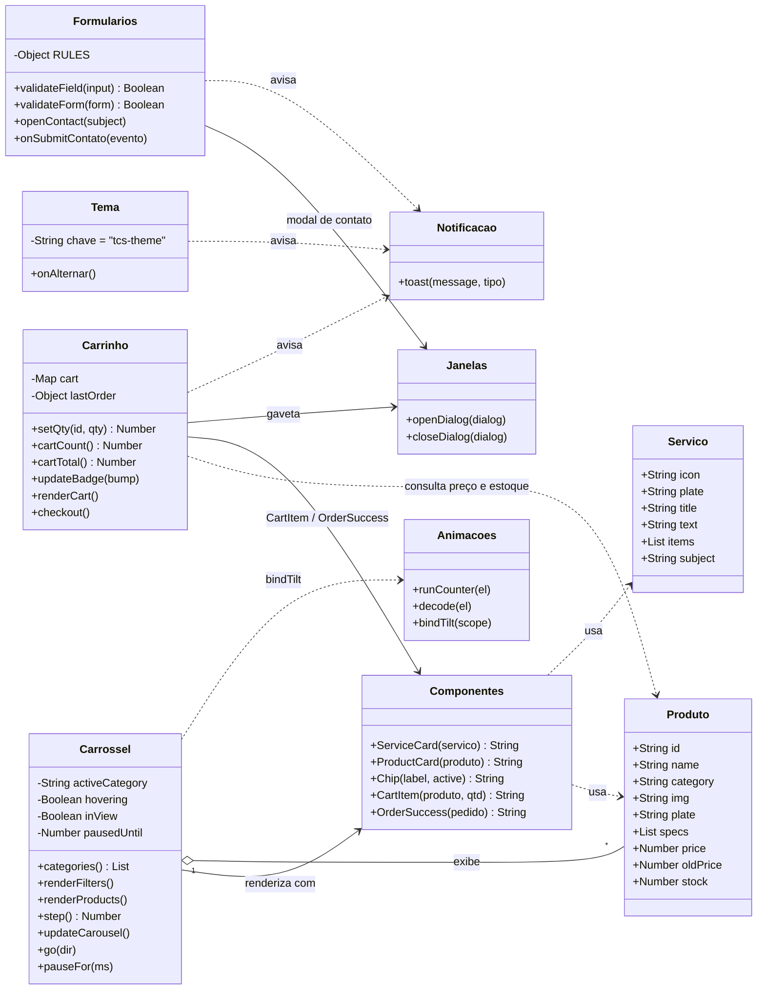
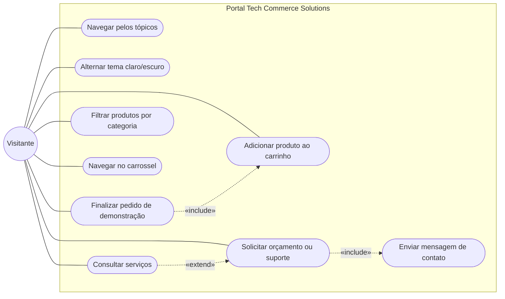
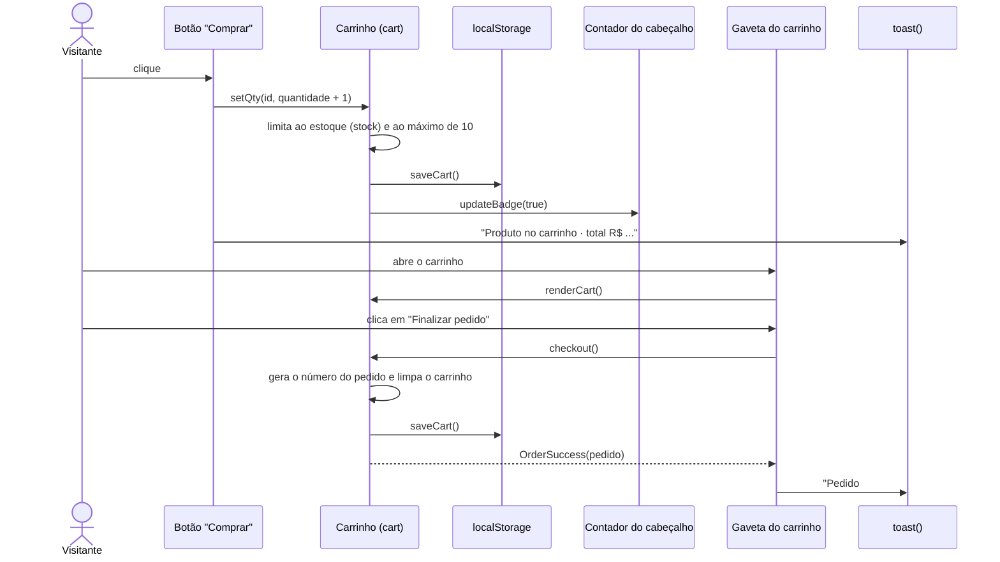
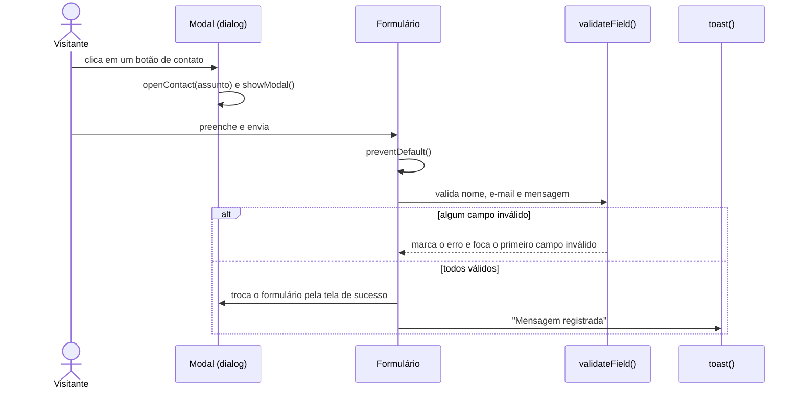
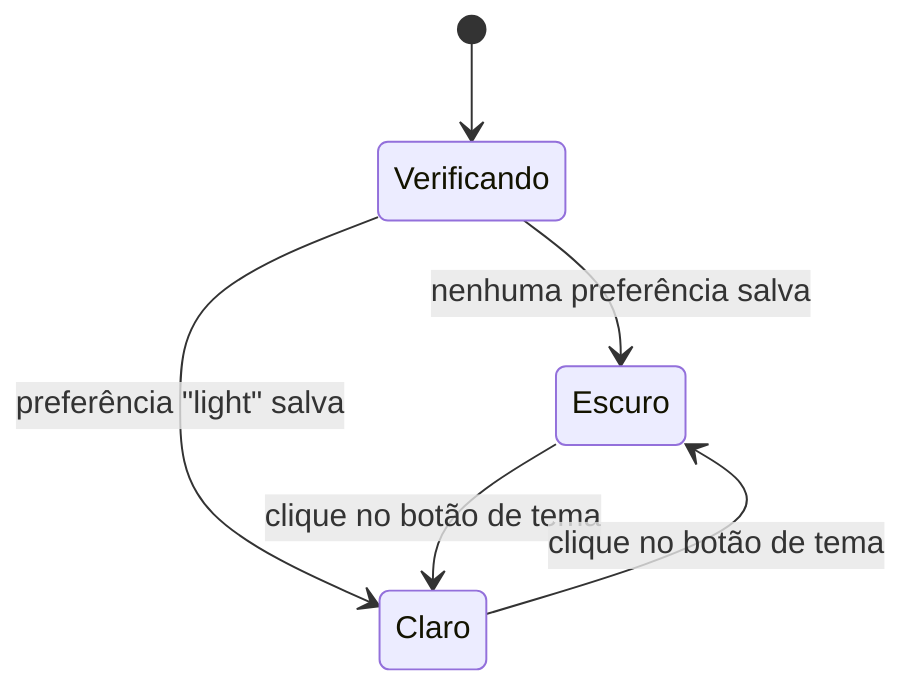
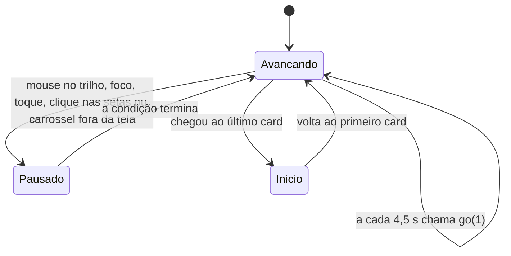

# Tech Commerce Solutions · Portal Institucional

Portal institucional responsivo para a **Tech Commerce Solutions**, empresa fictícia de comércio eletrônico e informática. O projeto foi desenvolvido para a **Atividade Prática 9 de Desenvolvimento Front End** (Prof. Jean Holguim), no estudo de caso "Modernização de Portal Institucional".

O visual é futurista, com camadas de cor sobrepostas, cards em relevo, seções em blocos e informações em movimento. O projeto é **somente front-end** (HTML, CSS com Tailwind e JavaScript puro), publicado na **Vercel** a partir deste repositório no **GitHub**.

> 🔗 **Site no ar:** `https://NOME-DO-PROJETO.vercel.app` *(troque pelo seu link depois de publicar na Vercel)*

---

## Sumário

- [Funcionalidades](#funcionalidades)
- [Tecnologias](#tecnologias)
- [Estrutura de pastas](#estrutura-de-pastas)
- [Como executar no computador](#como-executar-no-computador)
- [Publicação: GitHub + Vercel](#publicação-github--vercel)
- [Arquitetura](#arquitetura)
- [Componentização](#componentização)
- [Diagramas UML](#diagramas-uml)
- [Personalização rápida](#personalização-rápida)

---

## Funcionalidades

| Requisito da atividade | Como foi atendido |
|---|---|
| Cabeçalho | Logo, menu com destaque da seção atual, botão de contato, carrinho e troca de tema |
| Banner principal (Hero) | Nome da empresa, frase de impacto, botão **"Conheça nossos produtos"**, contadores animados e painéis flutuantes com parallax |
| Seção de Serviços | Cards de Venda de computadores, Assistência técnica, Equipamentos gamer e Infraestrutura de TI |
| Seção de Produtos | 7 produtos com imagem, nome, especificações, preço, parcelamento, estoque e botão **"Comprar"** |
| Sobre a empresa | Missão, Visão e Valores em cards sobrepostos |
| Rodapé | Redes sociais, endereço, contato e direitos autorais |
| Menu mobile | Menu hambúrguer animado, que fecha ao escolher um link ou com a tecla Esc |
| Dark mode | Tema claro e escuro, com a escolha salva no navegador |
| Carrossel de produtos | Setas, arraste, teclado, avanço automático, barra de progresso e filtro por categoria |
| Carrinho | Gaveta lateral com quantidades (limitadas ao estoque), remoção, total e pedido de demonstração; o conteúdo fica salvo no navegador |
| Contato | Formulário em janela modal, com validação em tempo real e tela de confirmação |

### UX/UI aplicada
- **Hierarquia visual:** escala tipográfica com três fontes (títulos, texto e dados técnicos).
- **Feedback visual:**
  - os botões têm brilho no hover, efeito de onda no clique e leve redução de tamanho ao pressionar;
  - o "Comprar" muda para "Adicionado", o contador do carrinho pula e aparece uma notificação;
  - durante o envio, os botões mostram "Enviando…".
- **Acessibilidade:**
  - link "Pular para o conteúdo" e foco visível no teclado;
  - `aria-label` nos botões de ícone e janelas `<dialog>` com foco preso;
  - respeito à preferência do sistema por menos movimento (`prefers-reduced-motion`).
- **Responsividade:** layout testado em celular (390 px), tablet (768 px) e desktop (1440 px), sem rolagem horizontal.

---

## Tecnologias

- **HTML5**: estrutura semântica (`header`, `nav`, `main`, `section`, `article`, `footer`, `dialog`)
- **CSS3**: variáveis (tokens de cor), `backdrop-filter`, `mix-blend-mode`, `clip-path`, animações com `@keyframes`
- **Tailwind CSS 3.4** (via Play CDN): grid responsivo, espaçamentos e utilitários
- **JavaScript** puro (sem frameworks)
- **Google Fonts**: Unbounded, Sora e JetBrains Mono
- **Vercel**: hospedagem, com publicação automática a cada `git push`

---

## Estrutura de pastas

```
tech-commerce-site/
├── index.html        # Estrutura da página e classes do Tailwind
├── README.md
├── css/
│   └── style.css     # Tokens de cor, componentes visuais, blocos e animações
├── js/
│   └── script.js     # Dados, componentes, tema, menu, carrossel, carrinho e contato
└── img/
    ├── logo.svg
    ├── notebook.svg
    ├── pc-gamer.svg
    ├── mini-pc.svg
    ├── monitor.svg
    ├── teclado.svg
    ├── mouse.svg
    └── headset.svg
```

---

## Como executar no computador

1. Clone o repositório:
   ```bash
   git clone https://github.com/SEU-USUARIO/NOME-DO-REPOSITORIO.git
   ```
2. Abra a pasta no **VS Code** e inicie com a extensão **Live Server** (botão direito no `index.html` › *Open with Live Server*). Também dá para abrir o `index.html` direto no navegador.
3. É preciso estar conectado à internet, porque o Tailwind e as fontes são carregados por CDN.

Não há instalação nem etapa de build: o site é feito de arquivos estáticos.

---

## Publicação: GitHub + Vercel

### 1. Enviar o projeto para o GitHub
Crie um repositório público no GitHub e envie os arquivos, deixando o `index.html` na raiz.

Pelo site: **New repository** › **uploading an existing file** › arraste o conteúdo da pasta › **Commit changes**.

Pelo terminal:
```bash
git init
git add .
git commit -m "Portal Tech Commerce Solutions"
git branch -M main
git remote add origin https://github.com/SEU-USUARIO/NOME-DO-REPOSITORIO.git
git push -u origin main
```

### 2. Publicar na Vercel
1. Acesse [vercel.com](https://vercel.com) e entre com a conta do **GitHub** (plano Hobby, gratuito).
2. Clique em **Add New… › Project** e escolha o repositório em **Import Git Repository**.
3. Na tela de configuração:
   - **Framework Preset:** `Other`
   - **Root Directory:** `./`
   - **Build Command** e **Output Directory:** deixe em branco
4. Clique em **Deploy**. Em poucos segundos o site fica no ar em um endereço `https://NOME-DO-PROJETO.vercel.app`.

### 3. Atualizar o site
Cada `git push` na branch `main` gera uma nova publicação automática na Vercel. Pull requests ganham um link de pré-visualização próprio.

---

## Arquitetura

O site é **estático**: não tem servidor nem banco de dados. A Vercel entrega os arquivos pela sua rede de distribuição (CDN). O navegador monta os cards com JavaScript e guarda o tema e o carrinho no `localStorage`.



### Camadas do `script.js`



---

## Componentização

Os elementos que se repetem são gerados por **funções componentes** em `js/script.js`, a partir das listas de dados:

| Componente | Dados | Onde aparece |
|---|---|---|
| `ServiceCard()` | `SERVICES` | Seção de Serviços |
| `ProductCard()` | `PRODUCTS` | Carrossel de Produtos |
| `Chip()` | categorias dos produtos | Filtros do carrossel |
| `CartItem()` | itens do carrinho | Gaveta do carrinho |
| `OrderSuccess()` | pedido de demonstração | Confirmação na gaveta |
| `toast()` | mensagem e tipo | Notificações de sucesso e erro |
| Janelas `<dialog>` | — | Contato e carrinho (`openDialog` / `closeDialog`) |

Para adicionar um produto, basta incluir um objeto na lista `PRODUCTS`:

```js
{ id: 'novo', name: 'Nome do produto', category: 'Periféricos', img: 'img/arquivo.svg',
  plate: 'plate-c1', specs: ['Spec 1', 'Spec 2'], price: 999.9, oldPrice: null, stock: 10 }
```

---

## Diagramas UML

O projeto usa JavaScript puro, sem `class`. Por isso o diagrama de classes mostra cada **módulo do `script.js` como uma classe conceitual**: os atributos são as variáveis de estado e os métodos são as funções reais do código. Métodos com prefixo `on` representam ouvintes de evento.

### Diagrama de classes



### Casos de uso



### Sequência: comprar e finalizar o pedido



### Sequência: enviar mensagem de contato



### Estados: tema



### Estados: avanço automático do carrossel



> O GitHub renderiza os blocos `mermaid` automaticamente. No VS Code, a extensão *Markdown Preview Mermaid Support* mostra os diagramas na pré-visualização.

---

## Personalização rápida

- **Cores:** altere `--c1` (ciano), `--c2` (magenta) e `--c3` (âmbar) no início de `css/style.css`. Os valores do tema escuro ficam em `html.dark`.
- **Textos:** edite diretamente o `index.html`.
- **Serviços e produtos:** edite as listas `SERVICES` e `PRODUCTS` em `js/script.js`.

---

## Observações

- A **Tech Commerce Solutions** é uma empresa fictícia. Endereço, telefones, e-mail e CNPJ são apenas ilustrativos.
- O carrinho e o formulário de contato funcionam no navegador e **não enviam dados**: o pedido é de demonstração, sem pagamento, e a mensagem não é enviada a ninguém. Os pontos onde entraria uma API estão comentados no `script.js`.
- O Tailwind é carregado pelo Play CDN, que é indicado para protótipos e trabalhos acadêmicos. Em um site comercial, o recomendado é gerar o CSS do Tailwind em uma etapa de build.
- As ilustrações dos produtos são SVGs próprios, feitos para este projeto.

---

## Autor

Desenvolvido por **Lucas** para a disciplina de Desenvolvimento Front End, com orientação do Prof. Jean Holguim.
